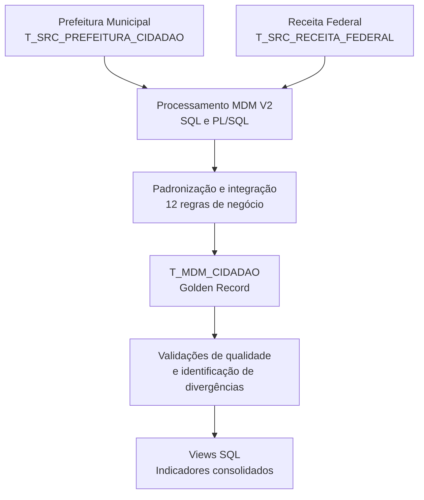

# Cidade Alfa — Master Data Management (MDM V2)

Projeto acadêmico de integração, padronização e consolidação de dados cadastrais de cidadãos, desenvolvido com **Oracle Database, SQL e PL/SQL**.

## Resultados do projeto

O processamento MDM V2 consolidou informações de duas fontes
cadastrais simuladas, aplicando regras de padronização,
integração e identificação de divergências.

| Indicador | Resultado |
|---|---:|
| Cidadãos processados | 100 |
| Regras de negócio | 12 |
| Registros atualizados | 100 |
| Novos registros inseridos | 0 |
| Divergências identificadas | 33 |
| Erros de processamento | 0 |

O processamento utiliza SQL e PL/SQL no Oracle Database,
com estratégia de atualização que preserva o identificador
do registro mestre (Golden Record).

## Arquitetura do processamento MDM

## Competências técnicas demonstradas

- **SQL:** consultas, JOINs, agregações, validações e criação de views.
- **PL/SQL:** desenvolvimento de procedimentos de processamento e aplicação de regras de negócio.
- **Master Data Management (MDM):** integração de fontes cadastrais e consolidação de registros mestres.
- **Qualidade de dados:** identificação de divergências, tratamento de valores nulos e padronização cadastral.
- **Golden Record:** manutenção de registros consolidados com preservação do identificador mestre.
- **Análise de dados:** construção de indicadores por faixa etária, escolaridade e estado civil.
- **Documentação técnica:** organização de scripts, registro de validações e relatório dos resultados.

## Origem dos dados e publicação responsável

Projeto acadêmico desenvolvido na FIAP a partir de arquivos CSV disponibilizados pela instituição para um **cenário simulado** da Cidade Alfa. As referências a Prefeitura Municipal e Receita Federal são parte desse cenário didático, não integrações com sistemas oficiais.

O tratamento, as regras de negócio, as validações e a evolução do processamento MDM V2 foram desenvolvidos no contexto da atividade acadêmica.

**Privacidade e direitos:** os arquivos cadastrais originais, o backup integral V1 e as capturas de tela com identificadores pessoais não fazem parte desta distribuição pública. A descrição de um cenário simulado não equivale a uma garantia de que cada CPF seja sintético ou de que a redistribuição dos arquivos seja autorizada. As evidências originais permanecem preservadas localmente.

## Sobre o projeto

O Cidade Alfa utiliza dados de duas fontes simuladas — Prefeitura e Receita Federal — para construir e atualizar uma base mestre de cidadãos.

A solução aplica 12 regras de negócio para padronizar os dados, comparar informações entre as fontes e registrar possíveis divergências.

## Tecnologias

- Oracle Database
- SQL e PL/SQL
- Oracle SQL Developer
- Visual Studio Code

## Arquitetura

| Tabela | Responsabilidade |
|---|---|
| `T_SRC_PREFEITURA_CIDADAO` | Fonte principal dos registros. |
| `T_SRC_RECEITA_FEDERAL` | Fonte complementar para comparação cadastral. |
| `T_MDM_CIDADAO` | Base mestre de cidadãos. |

O processamento percorre os registros da Prefeitura, consulta os dados correspondentes da Receita Federal e aplica as regras de negócio antes de atualizar ou inserir informações na tabela mestre.

## Como executar o projeto

### Pré-requisitos

- Oracle Database com acesso a um esquema de desenvolvimento.
- Oracle SQL Developer ou outra ferramenta compatível.
- Tabelas de origem e tabela mestre previamente criadas.
- Dados de teste autorizados para utilização.

### Preparação do ambiente

O projeto utiliza três tabelas principais:

- `T_SRC_PREFEITURA_CIDADAO`
- `T_SRC_RECEITA_FEDERAL`
- `T_MDM_CIDADAO`

Os dados originais utilizados na atividade acadêmica
não estão incluídos neste repositório público.

Antes da execução, é necessário preparar as estruturas
e disponibilizar dados de teste compatíveis com os
campos esperados pelos scripts.

### Processamento

1. Conferir as estruturas das tabelas e a sequência
   `SQ_MDM_CIDADAO`.
2. Revisar o script
   `script_carrega_dados_T_MDM_CIDADAO_v2_final.sql`.
3. Executar o processamento em ambiente de testes.
4. Executar as consultas de
   `validacoes_T_MDM_CIDADAO_v2.sql`.
5. Criar e consultar as views analíticas disponíveis
   na pasta `SQL/`.

**Atenção:** o script principal foi utilizado na
execução definitiva com `COMMIT`. Antes de executá-lo
novamente, revise o controle transacional e mantenha
um backup dos dados.

### Limitações de reprodução

Este repositório apresenta o processamento, as regras
de negócio e os resultados documentados. A reprodução
integral depende da preparação do ambiente Oracle,
das estruturas de banco necessárias e de dados de
teste compatíveis.

## Regras de negócio

O projeto contempla 12 regras:

1. Identificador mestre (`ID_GOLD_CIDADAO`).
2. Normalização do CPF.
3. Padronização e comparação de nomes.
4. Validação das datas de nascimento.
5. Cálculo da idade.
6. Classificação por faixa etária.
7. Padronização e comparação do sexo.
8. Padronização do estado civil.
9. Padronização da escolaridade.
10. Registro da data da carga.
11. Indicador de divergência.
12. Descrição das divergências.

## Resultados dos testes

A validação detalhada identificou:

- 27 divergências de nomes entre as fontes.
- 6 registros sem data de nascimento.
- 33 cidadãos com indicador de divergência.

Os resultados gerais do processamento estão
apresentados na seção **Resultados do projeto**.

A execução de teste realizada em **17/10/2026** foi concluída com sucesso, utilizando `ROLLBACK` para não persistir as alterações.

Após a criação dos backups da V1, foi realizada a **execução definitiva da V2 em 18/10/2026, às 16:04:29**, com `COMMIT` ativo.

O processamento apresentou 100 registros lidos, 100 atualizados, nenhuma inserção e zero erros. A validação posterior confirmou que os dados tratados estão disponíveis na tabela mestre `T_MDM_CIDADAO`.

## Estratégia de atualização

A V2 utiliza a estratégia **UPDATE antes de INSERT**.

Quando o CPF já existe na tabela mestre, o registro é atualizado e seu identificador é preservado. Quando não existe, um novo registro é inserido utilizando a sequência `SQ_MDM_CIDADAO`.

## Controle transacional

Durante a fase de testes, o script utilizou `ROLLBACK` para desfazer as alterações após a validação das regras de negócio.

Após a conclusão dos testes, foi criada uma cópia de segurança da V1 na tabela `T_MDM_CIDADAO_BACKUP_V1`, contendo 100 registros, além de um backup físico no arquivo `T_MDM_CIDADAO_BACKUP_V1.csv`.

Em 18/10/2026, às 16:04:29, o script V2 foi executado definitivamente com `COMMIT` ativo, confirmando 100 atualizações, nenhuma inserção e zero erros.

O `ROLLBACK` permanece no tratamento de exceções para desfazer alterações pendentes em caso de erro crítico.

Uma consulta posterior confirmou os dados tratados na tabela mestre: 100 cidadãos, 94 idades preenchidas, 94 faixas etárias preenchidas e 100 escolaridades preenchidas.

## Documentação e evidências

O projeto inclui, na versão local completa:

- `RELATORIO_TECNICO_MDM_V2.md`: documentação técnica consolidada.
- `script_carrega_dados_T_MDM_CIDADAO_v2_final.sql`: script principal.
- `validacoes_T_MDM_CIDADAO_v2.sql`: histórico das validações.

As capturas de tela originais permanecem armazenadas
na versão local do projeto. A pasta `EVIDENCIAS/`
deste repositório público contém apenas a documentação
sobre essas evidências, sem as imagens originais.

Os backups cadastrais também não foram publicados,
por motivos de privacidade e direitos de utilização.

### Backups e evidências da execução definitiva

A versão V1 foi preservada em dois formatos:

- **Backup no Oracle:** `T_MDM_CIDADAO_BACKUP_V1`, contendo 100 registros.
- **Backup físico:** `T_MDM_CIDADAO_BACKUP_V1.csv`, armazenado na pasta do projeto.

O projeto possui 22 evidências principais, incluindo:

- `EVIDENCIA_V2_18_ANALISE_FAIXA_ETARIA_ESCOLARIDADE.png` — análise dos 16 agrupamentos por faixa etária e escolaridade.
- `EVIDENCIA_V2_19_EXECUCAO_DEFINITIVA_COMMIT.png` — execução definitiva da V2 com 100 atualizações e zero erros.
- `EVIDENCIA_V2_20_VALIDACAO_APOS_COMMIT.png` — validação dos dados após a confirmação transacional.
- `EVIDENCIA_V2_21_VALIDACAO_VIEW_FAIXA_ETARIA_ESCOLARIDADE.png` — validação da view por faixa etária e escolaridade, com 16 agrupamentos.
- `EVIDENCIA_V2_22_VALIDACAO_VIEW_ESTADO_CIVIL.png` — validação da view por estado civil, com 5 categorias.

As evidências estão organizadas na pasta `EVIDENCIAS/`.

**Observação:** o arquivo CSV contém dados cadastrais e não deve ser publicado em um repositório público sem verificar e proteger essas informações.

## Views analíticas

Foram criadas e validadas duas views analíticas no Oracle Database, utilizando os dados consolidados da tabela `T_MDM_CIDADAO`.

| View | Análise | Resultado |
|---|---|---|
| `VW_MDM_QTD_FX_ETARIA_ESCOLARIDADE` | Quantidade de cidadãos por faixa etária e escolaridade | 16 agrupamentos, totalizando 100 cidadãos |
| `VW_MDM_QTD_ESTADO_CIVIL` | Quantidade de cidadãos por estado civil | 5 categorias, totalizando 100 cidadãos |

Os scripts estão disponíveis na pasta `SQL/`:

- `cria_view_qtd_total_fx_etaria_escolaridade.sql`
- `cria_view_qtd_total_estado_civil.sql`

As validações estão documentadas nas evidências 21 e 22.

## Status do projeto

**MDM V2 — implementação, validação funcional e persistência concluídas.**

Em 18/10/2026, a carga definitiva da V2 foi executada com sucesso no Oracle Database, utilizando `COMMIT`.

**Resultados confirmados:**
- 100 cidadãos na tabela mestre.
- 100 registros atualizados.
- Nenhuma inserção e zero erros.
- 94 idades preenchidas.
- 94 faixas etárias preenchidas.
- 100 escolaridades preenchidas.

A versão V1 foi preservada em backup no Oracle e em arquivo CSV.

**Views analíticas:** concluídas e validadas no Oracle Database, com 16 agrupamentos por faixa etária e escolaridade e 5 categorias de estado civil, totalizando 100 cidadãos em cada análise.

## Conteúdo desta versão pública

Esta versão disponibiliza os scripts SQL e a documentação técnica. O backup CSV original e as imagens de evidência ainda não foram incluídos, por dependerem de revisão de privacidade. Os resultados quantitativos registrados foram preservados na documentação.
